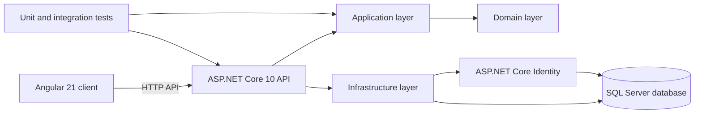

# School Management System

A school management application with an ASP.NET Core Web API backend and an Angular web client. The current implementation focuses on student records and student account registration, with persistence and automated tests in the backend.

## Architecture



The backend separates API, application, domain, and infrastructure responsibilities. Entity Framework Core migrations are stored with the infrastructure persistence code.

## Technology stack

### Backend

- .NET 10 and ASP.NET Core Web API
- Entity Framework Core 10 with SQL Server
- ASP.NET Core Identity for account management
- xUnit for unit and integration tests
- Swagger/OpenAPI via Swashbuckle

### Frontend

- Angular 21 with TypeScript
- Angular Router and Forms
- npm with a committed `package-lock.json`
- Vitest for frontend tests

## Implemented features

- Student record create, read, update, and delete API operations
- Student account registration and identity persistence
- Database schema migrations for student and identity data
- Backend unit and integration test projects
- Angular student list, detail, and add-student screens

## Planned roadmap

- Build a React client as an additional frontend option
- Deploy the application and supporting services to Microsoft Azure
- Extend school administration workflows and user experiences

These are roadmap items; they are not represented as completed features.

## Repository layout

```text
backend/
  SchoolManagementSystem.sln
  src/
    SchoolManagement.Api/              HTTP API and application startup
    SchoolManagement.Application/      Use cases and application contracts
    SchoolManagement.Domain/           Core domain model
    SchoolManagement.Infrastructure/   Persistence, Identity, migrations
  tests/
    SchoolManagement.UnitTests/
    SchoolManagement.IntegrationTests/
frontend/
  school-management-angular/           Angular application
```

## Prerequisites

- .NET 10 SDK
- Node.js compatible with Angular 21 and npm 11 (the frontend declares npm 11.6.2)
- SQL Server instance for local API persistence
- Git, if you are cloning the repository

## Local setup

### Backend

From the repository root, restore and build the solution:

```bash
dotnet restore backend/SchoolManagementSystem.sln
dotnet build backend/SchoolManagementSystem.sln
```

Configure the database connection and any authentication credentials through local .NET User Secrets or environment variables. Keep real credentials out of tracked `appsettings*.json` files. For the API project, initialize User Secrets if needed and set the expected configuration keys locally:

```bash
dotnet user-secrets init --project backend/src/SchoolManagement.Api/SchoolManagement.Api.csproj
dotnet user-secrets set "ConnectionStrings:SchoolManagementDatabase" "<local connection string>" --project backend/src/SchoolManagement.Api/SchoolManagement.Api.csproj
```

The API reads `ConnectionStrings:SchoolManagementDatabase`. Do not commit real connection strings or signing keys.

Run the API with:

```bash
dotnet run --project backend/src/SchoolManagement.Api/SchoolManagement.Api.csproj
```

Apply Entity Framework migrations with the EF Core CLI only after configuring a local database connection. The migrations are source files and should remain included in version control.

### Angular

In a second terminal:

```bash
cd frontend/school-management-angular
npm ci
npm start
```

The Angular client currently uses its configured API endpoint; update local development configuration as needed when running the API on a different URL. Do not place credentials in frontend configuration because values shipped to a browser are public.

## Local development URLs

- Angular development server: `http://localhost:4200/`
- Backend: use the HTTP or HTTPS URL printed by `dotnet run` and configured in `backend/src/SchoolManagement.Api/Properties/launchSettings.json`.
- Swagger UI is available at the API's `/swagger` route when enabled in the current environment.

The backend launch profiles currently define local HTTP and HTTPS URLs. Trust the local development certificate if using HTTPS.

## Database configuration

The API uses SQL Server through Entity Framework Core. Supply `ConnectionStrings:SchoolManagementDatabase` with .NET User Secrets or the environment variable `ConnectionStrings__SchoolManagementDatabase`. Keep local override files, credentials, and production connection details out of source control. Configuration templates may document key names and safe placeholders, but must not contain real credentials. User Secrets are stored outside the repository and are not shared with other developers.

## Testing

Run backend tests from the repository root:

```bash
dotnet test backend/SchoolManagementSystem.sln
```

Run frontend tests from the Angular project directory:

```bash
npm test
```

Integration tests may require the database or test infrastructure described by their test configuration.
